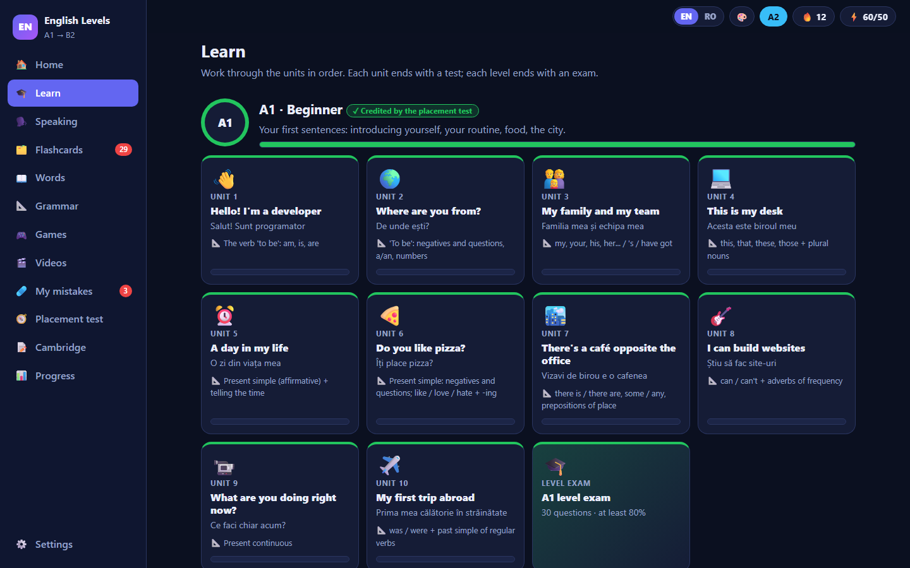
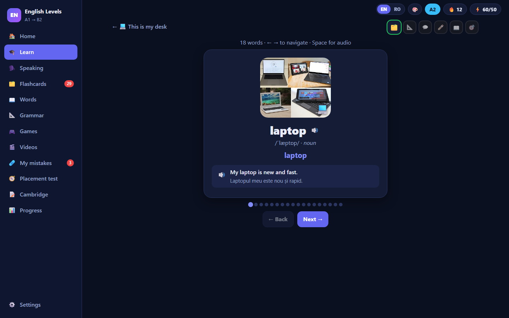
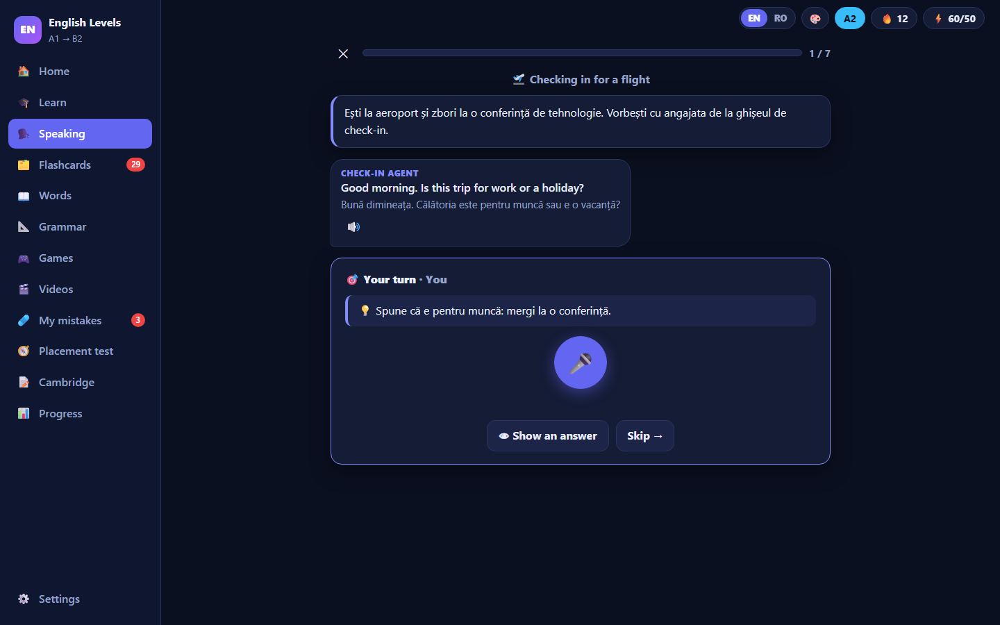
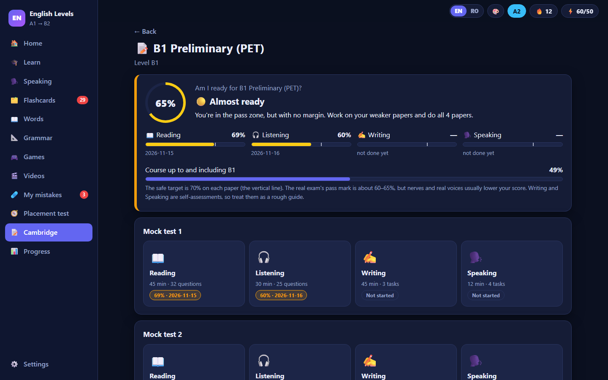

# English Levels · A1 → B2

A local app for learning English from **A1 to B2**, built for a Romanian speaker who works in software (clients, CRM, ERP) and also needs English for travel and everyday life.

It is organised in levels: each unit ends with a test and each level with an exam. If you fail, it sends you back to exactly the units you need to review. Besides the course, it has speaking practice with the microphone, spaced-repetition flashcards and Cambridge mock exams (PET and FCE).

| | |
|---|---|
|  |  |
| **Home** — what's next, day streak, your road to B2 | **Learn** — units by level and the level exams |
|  |  |
| **New words** — picture, pronunciation, example | **Speaking** — conversations where you answer aloud |
|  |  |
| **Progress** — daily chart, crypto-style | **Words** — learned / learning / to learn |
|  |  |
| **Cambridge** — "am I ready for the exam?" | **Grammar** explained in Romanian (light theme) |

<sub>The screenshots were taken with demo data.</sub>

## What's inside

- **A1 → B2 course:** 40 units, 10 per level. Each has new words, grammar explained in Romanian, a dialogue, exercises, a reading text and a final test. Half of each test is new questions — the same grammar and words in sentences you haven't seen in the unit — so it checks understanding, not memory.
- **Content:** about 2,950 words (a CEFR-sized vocabulary: ~600 by the end of A1, ~1,200 by A2, ~2,000 by B1, ~3,000 by B2), 960 exercises of 6 types (multiple choice, fill the gap, word order, translation, dictation, matching pairs) and 40 recommended videos (one per unit, each with a presenter on camera).
- **Placement test** at the start, so you can skip what you already know.
- **Speaking:**
  - 32 conversations (client, interview, negotiation, hotel, airport);
  - 240 phrases to repeat;
  - interview-style questions;
  - sound-alike word pairs (*ship / sheep*);
  - a voice sprint;
  - role-play from the lesson dialogues.
- **Word bank** in every unit: besides its 16–18 core words, each unit has 40–85 more common words of its level. You go through them 20 at a time ("I knew it" / "new for me"); the new ones go into the flashcards, the known ones come back once a week later as a check.
- **Irregular verbs:** about 180 verbs with their three forms (go – went – gone), most used first, as a tab of the Words page with search. You learn them 10 at a time by typing the past simple and the past participle (or test yourself first and skip the ones you know); they come back with spaced repetition and every correct answer earns XP.
- **Flashcards** with spaced repetition and a list of every word, where you can mark what you already know or check a whole level quickly.
- **Word games**, a "My mistakes" page, achievements and a daily goal.
- **Cambridge:** 2 full mock exams each for B1 Preliminary (PET) and B2 First (FCE), with an "am I ready?" indicator.
- **Settings:** interface language (EN / RO, English by default), 4 colour themes, voice and a microphone test.

## Getting started

You need [Node.js](https://nodejs.org) 18.11 or newer. For the speaking exercises use Chrome or Edge.

- **Windows:** double-click `Start.bat`. It opens `http://localhost:4747` by itself.
- **From a terminal:**

  ```bash
  npm start
  ```

Keep the black window open while you study. The server restarts itself when `server.js` changes, so after an update you only need to reload the page.

To use another port: `node server.js --port=4848`.

## Built with

| Part | Technology |
|---|---|
| Server | Node.js with no dependencies (only `http` and `fs`) — `server.js` |
| Interface | Plain HTML, CSS and JavaScript (ES modules), no framework and no build step |
| Text-to-speech | Web Speech API — `speechSynthesis` (Windows / browser voices) |
| Speech recognition | Web Speech API — `SpeechRecognition` in Chrome / Edge; if the online service is unavailable it falls back to on-device recognition |
| Recording | `MediaRecorder` (record yourself and listen back) |
| Word pictures | Wikipedia API (`page/summary`) |
| Videos | Embedded YouTube (`youtube-nocookie.com`) |
| Progress chart | Hand-drawn SVG, no chart library |
| Content | JSON files in `data/`, checked by the scripts in `tools/` |
| Progress | `user/progress.json`, plus a copy in `localStorage` |

Everything is free: no accounts, no API keys, no paid services.

## Project structure

```
server.js                 the server (sends the content, saves your progress)
Start.bat                 one-click start on Windows
public/                   the app that runs in the browser
  js/views/               the pages: lessons, speaking, words, Cambridge, settings…
  js/i18n.js              interface translations: L('română', 'English')
data/
  a1/ a2/ b1/ b2/         unit01–10.json, bank01–10.json (word banks), test01–10.json (new test questions),
                          placement.json, speaking.json
  verbs.json              the irregular verbs
  cambridge/pet|fce/      the mock exams
tools/                    content format (SCHEMA*.md) and validators
user/progress.json        your progress
docs/screenshots/         the screenshots in this README
```

## Progress and git

Progress is saved automatically to `user/progress.json`, and the file is kept in git on purpose (the repository is private). To keep an up-to-date copy on GitHub, commit and push from time to time.

Test profiles (`node server.js --profile=test` → `user-test/`) are ignored by git.

## Adding content

The format is described in `tools/SCHEMA.md` (lessons), `tools/SCHEMA-SPEAKING.md` (speaking) and `tools/SCHEMA-CAMBRIDGE.md` (exams). After any change in `data/`, run:

```bash
npm run validate
```

## Good to know

- The lessons, conversations and mock exams were written with the help of AI (Claude) and **have not been checked by a teacher**. If you find a mistake, fix it in the JSON file and run the validator.
- The Cambridge mock exams are original material that only follows the **format** of the real exams. For a final check, also use the official sample tests on the Cambridge website.
- Speech recognition checks whether it understood you; it does not grade your accent.
