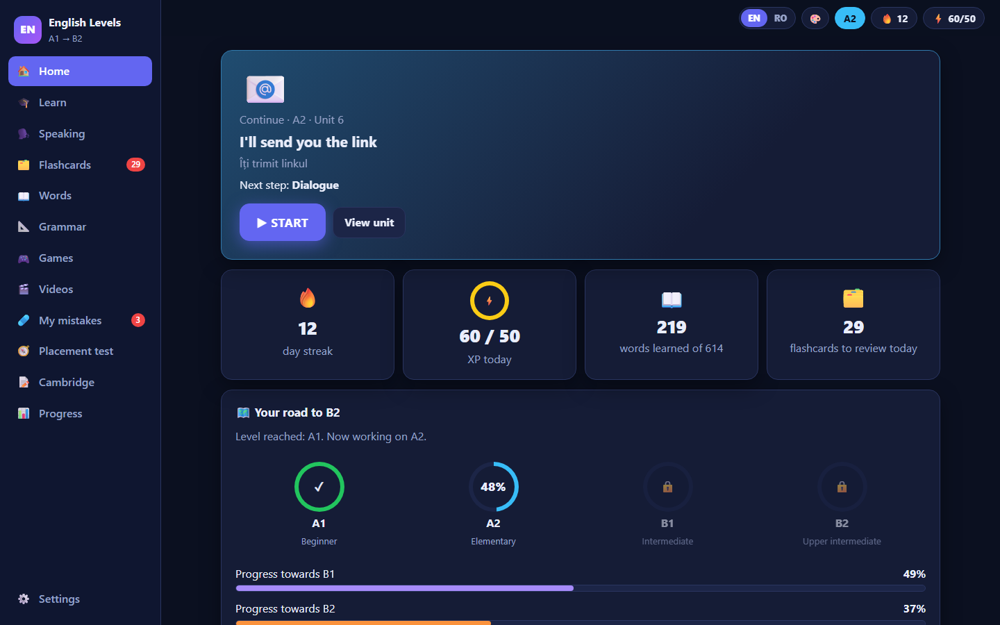
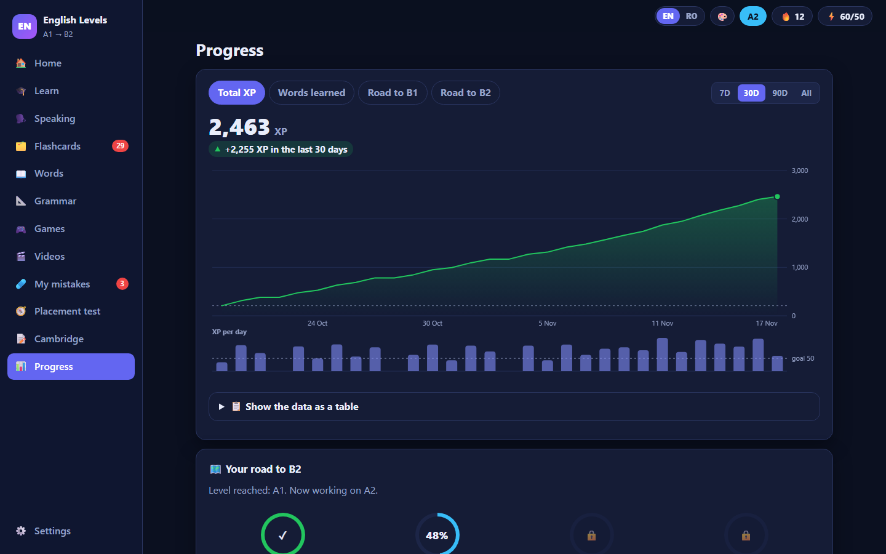
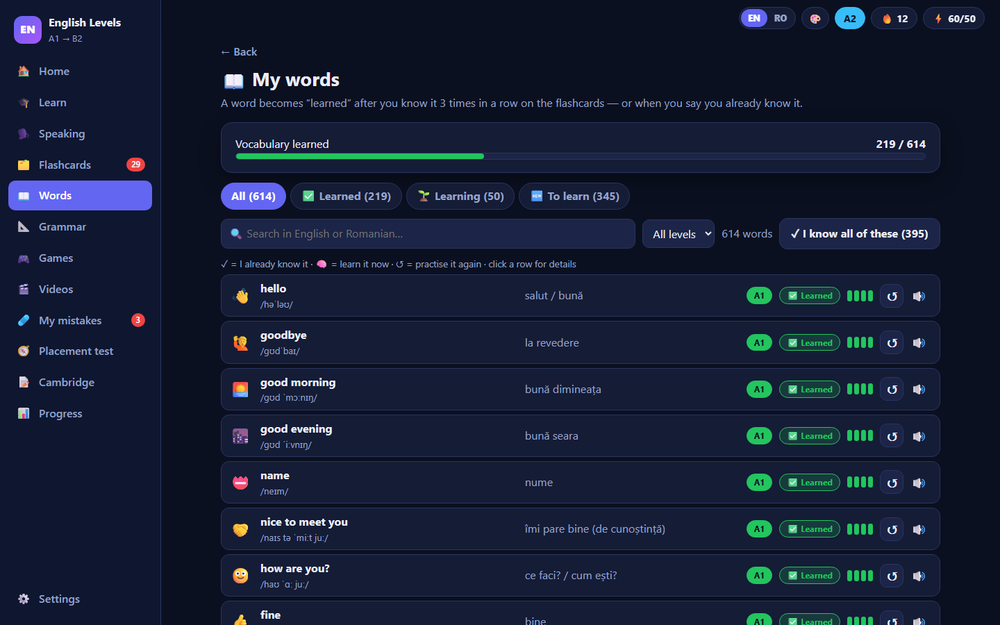
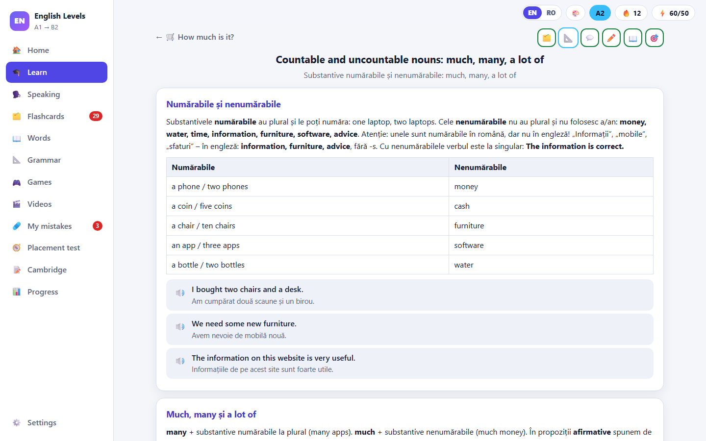

# English Levels · A1 → B2

Aplicație locală pentru învățat engleza de la **A1 la B2**, făcută pentru un vorbitor de română care lucrează în programare (clienți, CRM, ERP), dar și pentru călătorii și viața de zi cu zi.

Merge pe nivele: fiecare unitate se termină cu un test, fiecare nivel cu un examen, iar dacă nu treci te trimite înapoi exact la unitățile pe care trebuie să le repeți. Pe lângă curs are exerciții de vorbit cu microfonul, cartonașe cu repetare la intervale și simulări de examene Cambridge (PET și FCE).

| | |
|---|---|
|  |  |
| **Acasă** — ce urmează, zile la rând, drumul spre B2 | **Învață** — unitățile pe nivele și examenele |
|  |  |
| **Cuvinte noi** — poză, pronunție, exemplu | **Vorbire** — conversații în care răspunzi cu voce tare |
|  |  |
| **Progres** — grafic pe zile, ca la cripto | **Cuvinte** — învățate / în curs / de învățat |
|  |  |
| **Cambridge** — „sunt pregătit pentru examen?” | **Gramatică** explicată în română (tema luminoasă) |

<sub>Capturile sunt făcute cu date demo.</sub>

## Ce conține

- **Curs A1 → B2:** 40 de unități, câte 10 pe nivel. Fiecare are cuvinte noi, gramatică explicată în română, un dialog, exerciții, un text de citit și un test final.
- **Conținut:** aproximativ 614 cuvinte, 960 de exerciții de 6 tipuri (variante, completare, ordonarea cuvintelor, traducere, dictare, perechi) și 37 de videouri recomandate.
- **Test de nivel** la început, ca să sari peste ce știi deja.
- **Vorbire:**
  - 32 de conversații (client, interviu, negociere, hotel, aeroport);
  - 240 de fraze de repetat;
  - întrebări ca la interviu;
  - perechi de cuvinte care sună la fel (*ship / sheep*);
  - un sprint vocal;
  - joc de rol din dialogurile lecțiilor.
- **Cartonașe** cu repetare la intervale și o listă cu toate cuvintele, unde poți marca ce știi deja.
- **Jocuri** cu cuvinte, pagina „Greșelile mele”, realizări și obiectiv zilnic.
- **Cambridge:** câte 2 simulări complete pentru B1 Preliminary (PET) și B2 First (FCE), cu indicator „sunt pregătit?”.
- **Setări:** limba interfeței (EN / RO, engleza implicit), 4 teme de culori, vocea și testul de microfon.

## Cum pornești

Ai nevoie de [Node.js](https://nodejs.org) 18.11 sau mai nou. Pentru exercițiile de vorbit folosește Chrome sau Edge.

- **Windows:** dublu-click pe `Start.bat`. Se deschide singur la `http://localhost:4747`.
- **Din terminal:**

  ```bash
  npm start
  ```

Fereastra neagră trebuie să rămână deschisă cât înveți. Serverul se repornește singur când se schimbă `server.js`, deci după o actualizare e suficient să reîncarci pagina.

Pentru alt port: `node server.js --port=4848`.

## Cu ce e făcut

| Parte | Tehnologie |
|---|---|
| Server | Node.js, fără nicio dependență (doar `http` și `fs`) — `server.js` |
| Interfață | HTML, CSS și JavaScript simplu (ES modules), fără framework și fără build |
| Vocea care citește | Web Speech API — `speechSynthesis` (vocile din Windows / browser) |
| Recunoașterea vorbirii | Web Speech API — `SpeechRecognition` din Chrome / Edge; dacă serviciul online nu merge, folosește recunoașterea locală, pe calculator |
| Înregistrare | `MediaRecorder` (te înregistrezi și te asculți) |
| Poze pentru cuvinte | API-ul Wikipedia (`page/summary`) |
| Videouri | YouTube încorporat (`youtube-nocookie.com`) |
| Grafic de progres | SVG desenat de mână, fără bibliotecă |
| Conținut | fișiere JSON în `data/`, verificate de scripturile din `tools/` |
| Progres | `user/progress.json`, plus o copie în `localStorage` |

Totul e gratuit: fără conturi, fără chei de API, fără servicii plătite.

## Structura

```
server.js                 serverul (trimite conținutul, salvează progresul)
Start.bat                 pornire pe Windows
public/                   aplicația din browser
  js/views/               paginile: lecții, vorbire, cuvinte, Cambridge, setări…
  js/i18n.js              traducerile interfeței: L('română', 'English')
data/
  a1/ a2/ b1/ b2/         unit01–10.json, placement.json, speaking.json
  cambridge/pet|fce/      simulările de examen
tools/                    formatul conținutului (SCHEMA*.md) și validatoarele
user/progress.json        progresul tău
docs/screenshots/         capturile din README
```

## Progresul și git

Progresul se salvează automat în `user/progress.json`, iar fișierul e păstrat intenționat în git (repo-ul e privat). Ca să ai o copie la zi pe GitHub, fă din când în când commit și push.

Profilele de test (`node server.js --profile=test` → `user-test/`) sunt ignorate de git.

## Conținut nou

Formatul e descris în `tools/SCHEMA.md` (lecții), `tools/SCHEMA-SPEAKING.md` (vorbire) și `tools/SCHEMA-CAMBRIDGE.md` (examene). După orice modificare în `data/`:

```bash
npm run validate
```

## De știut

- Lecțiile, conversațiile și simulările au fost scrise cu ajutorul AI-ului (Claude) și **nu au fost verificate de un profesor**. Dacă găsești o greșeală, corecteaz-o în fișierul JSON și rulează validatorul.
- Simulările Cambridge sunt originale, doar în **formatul** examenului real. Pentru o verificare finală folosește și testele-model oficiale de pe site-ul Cambridge.
- Recunoașterea vocii verifică dacă te-a înțeles, nu îți notează accentul.
